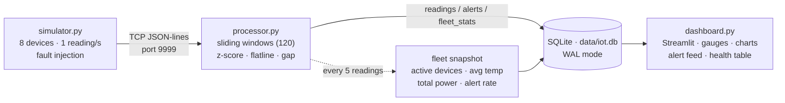

# Real-Time IoT Analytics — Live Fleet Monitoring

## Overview
A real-time telemetry pipeline for a fleet of smart-home devices: a sensor
simulator streams multivariate readings (temperature, humidity, power,
vibration) over a socket, a stream processor computes rolling aggregations and
detects anomalies on sliding windows, and a Streamlit dashboard renders the
fleet live — CloudWatch-style.

I built this because it sits exactly at the intersection of my background: three
years testing 150+ IoT devices (where I lived in AWS IoT and CloudWatch
dashboards watching for misbehaving firmware) and my MS in Data Science at
Wentworth. It is the kind of system I used to monitor as a tester, rebuilt now
from the data-engineering side.

> The sensor data is **simulated** with realistic signal models (daily
> temperature waves, appliance power cycles, sensor noise) plus injected
> faults — stuck sensors, spikes, surges, and dropouts — so the anomaly
> detector has ground truth to catch during the demo.

## Architecture

```
┌─────────────┐   TCP JSON lines    ┌──────────────┐   SQLite    ┌───────────────┐
│  simulator  │ ──────────────────▶ │  processor   │ ──────────▶ │   dashboard   │
│  8 devices  │   1 reading/        │  sliding     │  readings / │  Streamlit    │
│  temp/humid │   device/sec        │  windows,    │  alerts /   │  gauges,      │
│  power/vib  │                     │  z-score +   │  fleet      │  charts,      │
│  + faults   │                     │  flatline +  │  stats      │  alert feed   │
└─────────────┘                     │  gap detect  │             └───────────────┘
                                    └──────────────┘
```



## Project structure
```
├── config.py              # ports, thresholds, window sizes (single source of truth)
├── run_demo.py            # one-command launcher (simulator + processor + dashboard)
├── Makefile               # setup / test / demo / simulator / processor / dashboard
├── requirements.txt
├── .github/workflows/ci.yml # py_compile + pytest on push/PR
├── .streamlit/config.toml # dark CloudWatch-style theme
├── src/
│   ├── models.py          # device fleet definition (8 smart-home devices)
│   ├── simulator.py       # TCP server: realistic signals + fault injection
│   ├── processor.py       # TCP client: windows, aggregations, anomaly detection → SQLite
│   └── dashboard.py       # Streamlit: KPIs, gauges, time series, alert feed, health table
├── tests/                 # pytest suite (56 tests)
│   ├── test_detect.py     # z-score / flatline / offline / recovery detection
│   ├── test_simulator.py  # signal models, fault injection, determinism
│   ├── test_models.py     # fleet definition invariants
│   └── test_store.py      # SQLite persistence: readings, alerts, fleet snapshots
├── examples/
│   └── ingest_session.py  # in-process spike → stuck → offline → recovery walkthrough
└── data/                  # created at runtime (SQLite store, git-ignored)
```

## How to run
```bash
pip install -r requirements.txt

# Option A — one command (recommended for the demo):
python run_demo.py
# → dashboard at http://localhost:8501

# Option B — three terminals, same result:
python -m src.simulator     # terminal 1: start the sensor stream
python -m src.processor     # terminal 2: start the stream processor
streamlit run src/dashboard.py   # terminal 3: open the dashboard
```

Give it ~30 seconds: windows need to fill before z-scores are trusted, and the
simulator injects a fault every couple of minutes per device on average — watch
the alert feed catch spikes, stuck sensors, and dropouts live. Every message
carries an `injected_fault` label (which the processor ignores) so you can
verify each detection against ground truth.

## How anomaly detection works
Per device, the processor keeps a sliding window (default: last 120 readings)
per metric and runs three detectors:

1. **Z-score** — a reading whose |z| against its own rolling window exceeds 3.0
   is flagged. Window statistics are computed *before* the new reading is
   appended, so spikes can't dilute their own baseline.
2. **Flatline** — zero variance over the last 30 ticks on a metric that should
   vary means a stuck sensor.
3. **Gap sweep** — no reading for 4× the expected interval means the device is
   offline; a `recovered` alert fires when it resumes.

All alerts are **edge-triggered**: one alert per episode, never alert storms.
Fleet-level snapshots (active devices, avg temperature, total power, alert
rate) are written every 5 readings — the same shape as CloudWatch custom
metrics.

## Key design decisions
- **TCP sockets instead of Kafka for the demo** — zero infrastructure to run,
  but the producer/consumer framing is identical (see mapping below). JSON-lines
  framing keeps parsing trivial and debuggable with `nc`.
- **SQLite with WAL mode as the store** — file-based, survives process
  restarts, and the schema (readings / alerts / fleet_stats) maps 1:1 onto a
  time-series database.
- **Processor never sees fault labels** — `injected_fault` is ground truth for
  *you*, not an input to detection. The detector earns its alerts.
- **Warm-up gating** — z-scores are suppressed until 20 readings are buffered,
  avoiding false positives on startup.

## Production mapping
| Demo | Production |
|---|---|
| TCP socket JSON-lines | Kafka topic (one partition per device type) |
| `processor.py` sliding windows | Kafka Streams / Flink windowed aggregations |
| SQLite | AWS Timestream or InfluxDB |
| Streamlit dashboard | CloudWatch dashboards / Grafana |
| z-score + heuristics | Same as a first line, Isolation Forest / autoencoder on windows as the second line |

## Tests and CI
56 pytest tests, all in-process — no simulator, no sockets, no dashboard
needed. The processor tests run against a temporary SQLite DB; the simulator
tests use seeded, deterministic signals.

```bash
make test            # byte-compile + full suite
python -m pytest -q  # same, without the compile step
```

| File | Covers |
|---|---|
| `tests/test_detect.py` | z-score, flatline, offline gap sweep, recovery, edge triggering |
| `tests/test_simulator.py` | signal ranges, fault injection (spike/stuck/surge/dropout), determinism |
| `tests/test_models.py` | fleet invariants: 8 devices, unique ids, per-type metrics, baselines |
| `tests/test_store.py` | SQLite writes: readings, alerts, fleet snapshots, offline/recovery |

CI (`.github/workflows/ci.yml`) runs `py_compile` + `pytest` on every push
and pull request (Python 3.11).

### Make shortcuts
```bash
make setup      # pip install -r requirements.txt
make test       # compile + pytest
make demo       # simulator + processor + dashboard in one command
make simulator  # python -m src.simulator
make processor  # python -m src.processor
make dashboard  # streamlit run src/dashboard.py
make clean      # remove data/, caches, and .pyc files
```

## FAQ / troubleshooting
- **Dashboard says "Waiting for data"** — the processor only writes once the
  simulator is streaming. Start `python -m src.simulator` first, then
  `python -m src.processor`, and give the windows ~20 seconds to warm up
  (`MIN_WINDOW_FOR_STATS = 20` in `config.py`).
- **No alerts after several minutes** — normal: the simulator injects a fault
  roughly every couple of minutes per device on average. Every message
  carries an `injected_fault` label you can compare against the alert feed.
- **Port 9999 already in use** — a previous simulator is still running.
  Kill it, or pass `--port` to both simulator and processor.
- **Stale data in the dashboard** — stop everything and delete the store:
  `make clean` (removes `data/iot.db`), then restart the demo.
- **Alerts firing on startup** — they should not: z-scores are suppressed
  until 20 readings are buffered, and every alert is edge-triggered, so one
  alert per episode. If you see a burst, check for a stuck simulator clock
  (readings arriving with identical timestamps).

## What's next
- Swap the socket layer for a real Kafka topic with `kafka-python` (interfaces are already producer/consumer shaped).
- Add an Isolation Forest scorer over windowed feature vectors alongside the z-score detector.
- Persist windows to Redis so the processor can scale horizontally.
